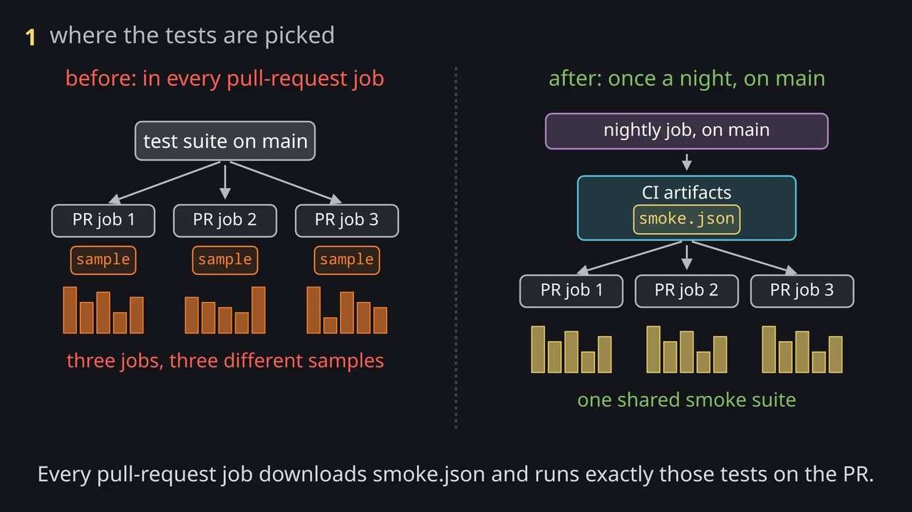
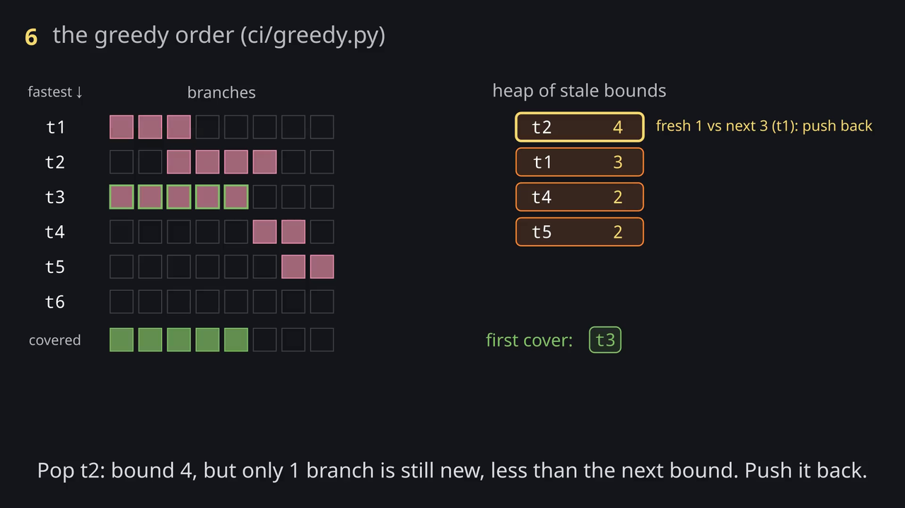
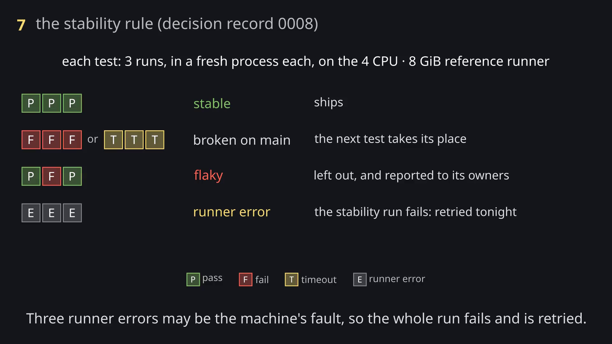

# pr-explainer-video

An agent skill that turns a pull request into a short explainer video in the style of
3Blue1Brown: a dark background, a few shapes, one idea at a time, each animated into place while
a one-line caption says what is happening. A reviewer watches it for a few minutes and gets a
mental model of the change before reading the diff.

You give your agent a pull request:

> explain to me this PR https://github.com/owner/repo/pull/123

The agent reads the PR, writes down every fact it will show along with its source, storyboards
the video, and writes the scenes in [manim](https://www.manim.community/). It checks the layout
and the facts, then renders a 1080p60 mp4 with captions and no voice, usually 2–8 minutes long.

## See one

[![The powersort merge tree, from the example video][preview]][video]

**[Watch the full video][video]** (4 min 7 s, 1080p60): an explainer of
[python/cpython#28108](https://github.com/python/cpython/pull/28108), in which `list.sort()`
switched to the *powersort* merge order. It was made with this skill: every fact on screen is traced
to the PR, and its worked examples were computed with CPython's own C code. The scenes, the facts
with their sources, and the script that recomputes them are in [examples/powersort](examples/powersort). The videos are attached to the
release, not committed, so that clones stay small.

[video]: https://github.com/ethan42/pr-explainer-video/releases/download/v0.1.0/powersort.mp4
[preview]: https://github.com/ethan42/pr-explainer-video/releases/download/v0.1.0/powersort-preview.gif

The skill also carries a worked example of its own: a 13-scene, 7-minute video about a **fictional**
PR that adds a nightly smoke-test suite to a project's CI. Three stills from it:





## What makes the videos good

The skill's instructions build in these habits:

- **Every fact is checked.** Each number, name and limit on screen is traced to the PR, its
  design notes or the code.
- **A diagram shows a mechanism**: where data flows, what changes between before and after, what
  a cache key contains.
- **Algorithms are shown working**, on tiny concrete data, with each step computed by the PR's
  own code.
- **Each new name gets a picture**, introduced once, in the place it lives.
- **Each color has one meaning** for the whole video.

## What is inside

```
skills/pr-explainer-video/
├── SKILL.md                    the workflow the agent follows
├── scripts/
│   ├── pv.sh                   render, check, join and grab frames, all in one command
│   ├── pvtool.py               contact sheets, lossless join, frame grabs (PyAV and Pillow)
│   └── pr3b1b.py               house style, drawing helpers and an automatic layout check
└── references/
    ├── storyboard.md           the usual arc, scene patterns, caption rules, pacing
    ├── manim-pitfalls.md       bugs that come up again and again, with their fixes
    └── example.py              the worked example: 13 scenes, every pattern in use
examples/powersort/             a real PR's video: its scenes, facts and their recomputation
tests/                          planted layout problems for the check, a clean scene for pv.sh text
```

The layout check runs with every draft render. It reports text that leaves the frame, text that
touches or overlaps other text, a line or arrow that crosses text, anything in the caption band,
text too small to read, and captions that had to shrink. The draft render also writes one contact
sheet per scene, with one frame per caption, so the agent can look at every step it drew, and
`pv.sh text` lists every caption and on-screen text, so that each number can be checked against its
source.

## Requirements

- **Docker.** `pv.sh` runs manim, LaTeX, fonts, PyAV and Pillow from the
  `manimcommunity/manim:v0.22.0` image (amd64 and arm64), so nothing else needs installing. Without
  Docker, install manim 0.22 with Cairo, Pango and the Noto fonts, and set `PV_NATIVE=1`; SKILL.md
  has the commands.
- **git**, and read access to the repository. The GitHub CLI `gh` helps, but is optional.
- An agent that can run shell commands and read images.

## Install

**Claude Code:** copy the skill folder into your personal skills, or into one project's skills:

```bash
cp -r skills/pr-explainer-video ~/.claude/skills/          # every project
cp -r skills/pr-explainer-video <repo>/.claude/skills/     # one project
```

**As one file:** `make package` builds `dist/pr-explainer-video.skill`, a zip of the skill
folder, for tools that install a skill from a file.

**Other agents:** give the agent the `skills/pr-explainer-video` folder and tell it to follow
`SKILL.md`.

## Use

Ask for an explanation of a PR, a PR stack or a large change. The skill triggers on requests like
"explain this PR", "walk me through this stack" or "make a 3b1b video of this change". The agent
works in a scratch directory and never checks out the PR in your working copy. A video takes about
an hour of agent time, and the final render runs in the background at 2–4 minutes per minute of
video.

The tools also work on their own, from a directory holding a scene file and the three scripts:

```bash
./pv.sh low topic.py              # 480p draft, layout warnings, contact sheets in sheets/
./pv.sh check topic.py S03Facts   # layout warnings only, for one or two scenes
./pv.sh text topic.py             # every caption and on-screen text, for the fact check
./pv.sh high topic.py             # every scene at 1080p60, joined into topic.mp4
./pv.sh frames topic.mp4 20 150   # stills at those times, one strip of them all, and stats
```

## Development

```bash
make test                              # planted problems are caught; both examples pass
make example                           # render the worked example to build/example.mp4
examples/powersort/verify/verify.sh    # recompute the powersort figures from CPython's C
```

CI runs the tests, shellcheck and the powersort recomputation on every push and pull request.

## Credits

The visual style follows the videos of [3Blue1Brown](https://www.3blue1brown.com/). This project
is not affiliated with 3Blue1Brown. It is built on
[Manim Community Edition](https://github.com/ManimCommunity/manim).

## License

[MIT](LICENSE)
